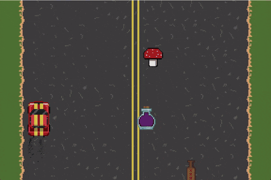

# Car Driving Simulation

A 2D graphics project in C++ and OpenGL 3.3 demonstrating real-time rendering techniques, particle systems, framebuffer effects, and stencil-based rendering. The player controls a car while collecting randomly generated objects that trigger different visual and gameplay effects.

<p align="center">
  
</p>

The full demo video is in [`media/demo.mp4`](media/demo.mp4).

## Features

### Car Movement
- The car can be controlled using **WASD** keys.
- The car is constrained to the road and cannot leave the screen boundaries.
- The movement speed gradually increases over time.

### Particle System
- Smoke particles are emitted from the car exhaust.
- Particles use alpha blending to create a transparent effect.
- Particle colors can change dynamically depending on active effects.

### Collectible Objects and Effects

Objects are randomly generated on the road and can be collected by the player:

#### Mushroom
- Applies a full-screen color distortion effect using bilinear interpolation.
- Effect intensity and colors are randomly generated.
- The effect gradually fades until it disappears.
- While active, exhaust particles change color.

#### Drink
- Reverses the car's movement controls for 5 seconds.

#### Bottle
- Creates a spiral directional blur effect.
- The blur direction follows a rotating vector that gradually decreases in magnitude until the effect disappears.
- Implemented using a framebuffer.

#### Mud
- When the car drives through mud, random circular stains are rendered on the screen using stencil buffering.
- Multiple mud effects can accumulate if collected within a short time interval.
- Stains are automatically cleaned after several seconds.

### Additional Features
- **Pause (P key)**
  - Inverts screen colors while paused.
  - Preserves the current directional blur vector and mushroom effect intensity.

- **Screen Rotation (R key)**
  - Rotates the entire scene.

- **Exit (ESC key)**
  - Closes the game.

### Procedural Road Generation
- The road is generated dynamically by randomly selecting and placing tiles.

## Controls

| Key | Action |
|---|---|
| W A S D | drive |
| P | pause |
| R | rotate the scene |
| Esc | quit |

## Building

Requirements: CMake 3.14 or newer, a C++17 compiler and a GPU with OpenGL 3.3. GLFW and GLM are downloaded by CMake; GLAD and stb_image are included in the repository.

```bash
cmake -S . -B build -DCMAKE_BUILD_TYPE=Release
cmake --build build --config Release
```

On Linux, GLFW needs the X11 development packages, for example on Ubuntu:

```bash
sudo apt install libx11-dev libxrandr-dev libxinerama-dev libxcursor-dev libxi-dev libgl1-mesa-dev
```

## Running

The build copies the shaders (`Glsls/`) and the textures (`resources/`) into the build folder, and the program loads them with relative paths, so run it from there:

```bash
cd build
./car_driving
```

